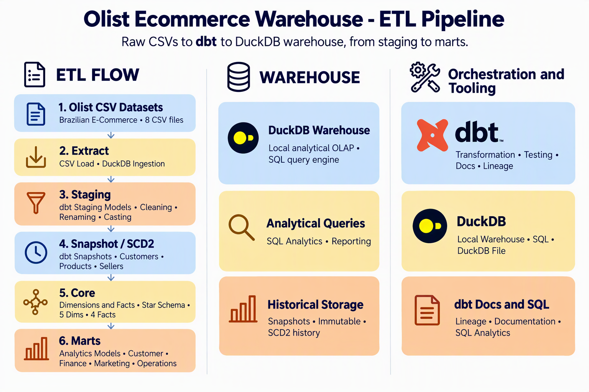

# E-commerce Lakehouse Pipeline

An end-to-end data engineering project that transforms Brazilian e-commerce data from the Olist marketplace into tested, analysis-ready tables and dashboards.

The project demonstrates a practical medallion architecture:

- **Bronze / raw:** Source CSV data loaded into DuckDB
- **Silver / staging:** Renamed, typed, cleaned, and standardized dbt models
- **Gold / core:** Dimensions and fact tables in a star schema
- **Analytics marts:** Business-focused tables for customer, marketing, finance, and operations analysis

## Architecture



**Data flow:** Source CSV files -> DuckDB raw tables -> dbt staging models -> dbt snapshots -> dbt core models -> dbt analytics marts -> Parquet exports -> Rill dashboards

The repository also includes a detailed [data model ERD](docs/ecommerce_data_model_erd.png) and the matching [DBML source](docs/ecommerce_data_model.dbml).

## Technology

- [Python](https://www.python.org/) for data setup and Parquet exports
- [DuckDB](https://duckdb.org/) for local storage and SQL analytics
- [dbt](https://www.getdbt.com/) for data transformation, snapshots, testing, and documentation
- [Rill](https://www.rilldata.com/) for interactive business dashboards
- SQL and CSV for the source and transformation layers
- [Docker Desktop](https://www.docker.com/products/docker-desktop/) with WSL 2 for running the project containers

Python, DuckDB, dbt, and Rill run inside Docker containers; they do not need to be installed separately on your computer.

## Data Model

The dbt project is organized into four main layers.

### Staging

Staging models standardize the source data and expose one clean model for each source table:

- Customers
- Geolocation
- Orders
- Order items
- Payments
- Reviews
- Products
- Sellers
- Product category translations

### Snapshots

Slowly changing dimensions use dbt snapshots to retain historical versions of:

- Customers
- Products
- Sellers

### Core

The core layer contains the star schema:

**Dimensions**

- `dim_customers`
- `dim_dates`
- `dim_payment_types`
- `dim_products`
- `dim_sellers`

**Facts**

- `fact_orders`
- `fact_sales`
- `fact_payments`
- `fact_reviews`

### Analytics marts

The marts provide reusable outputs for dashboards and reporting:

- `mart_customer_metrics` - Customer lifetime value, order behavior, delivery performance, and review activity
- `mart_marketing_performance` - Monthly and geographic marketing performance
- `mart_monthly_revenue` - Monthly revenue, freight, order volume, and late-delivery trends
- `mart_operations_performance` - Delivery speed, shipping volume, freight cost, and late-order performance

## Project Structure

```text
.
|-- data/
|   |-- raw/                  # Olist source CSV files
|   |-- bronze/               # Bronze data artifacts
|   |-- silver/               # Silver data artifacts
|   |-- gold/                 # Gold data artifacts
|   `-- ecommerce.duckdb      # Main DuckDB database
|-- dbt_project/
|   |-- models/
|   |   |-- staging/          # Cleaned staging views
|   |   |-- core/             # Dimensions and facts
|   |   `-- marts/            # Business analytics models
|   |-- snapshots/            # Slowly changing dimension snapshots
|   |-- tests/                # Reconciliation and data quality tests
|   `-- sql/load_raw_tables.sql
|-- docs/                     # Architecture and data model images
|-- olist_dashboard/          # Rill dashboard project
|-- profiles/                 # Local dbt DuckDB profile
|-- export_marts.py           # Export selected marts to Parquet
|-- export_parquet.py         # Export the fact and finance models to Parquet
`-- convert_db.py             # Convert the database to DuckDB storage version v1
```

## Getting Started

### Prerequisites

- Docker Desktop for Windows with the WSL 2 backend. [Download Docker Desktop](https://www.docker.com/products/docker-desktop/).
- WSL 2 enabled in Windows and Docker Desktop configured to use its WSL 2 backend.

You do **not** need to install Python, dbt, DuckDB, or Rill on your computer. They all run inside Docker containers.

### Run dbt

Start Docker Desktop and wait for it to finish starting. Then open PowerShell or another terminal and change to the project root (the folder containing `docker-compose.yaml`):

```powershell
cd C:\projects\E-commerce_Lakehouse_Pipeline
```

If you cloned the repository to a different location, use that folder's path. Do not run Compose from inside `olist_dashboard`.

Run the dbt transformations:

```powershell
docker compose up dbt
```

Run the services one by one and in order, especially if your computer has limited memory. Do not start all three services at once.

## Export Dashboards

From the project root, export the dashboard data to Parquet:

```powershell
docker compose up python-export
```

The exported files are written to `olist_dashboard/` for Rill to use.

## Run the Dashboard

From the project root, start Rill:

```powershell
docker compose up rill
```

Open [http://localhost:9009](http://localhost:9009) in your browser. Press **Ctrl+C** in the terminal to stop Rill.

A deployed example is available at [Rill Dashboard](https://ui.rilldata.com/Wisdom/olist_dashboard).

## Validation

The project includes reconciliation tests for:

- Orders
- Payments
- Reviews
- Sales
- Monthly revenue
- Customer metrics
- Marketing performance
- Operations performance

Run all dbt tests with:

```powershell
docker compose run --rm dbt dbt test --project-dir /usr/app/dbt --profiles-dir /root/.dbt
```

## Data Source

The source data is the public Olist Brazilian e-commerce dataset. It contains marketplace orders, customers, sellers, products, order items, payments, reviews, geolocation, and product category translation.

## License

MIT License

Copyright (c) 2026 Wisdom Mpamugo Chinemere

Permission is hereby granted, free of charge, to any person obtaining a copy
of this Project and associated documentation files (the "Project"), to deal
in the Project without restriction, including without limitation the rights
to use, copy, modify, merge, publish, distribute, sublicense, and/or sell
copies of the Project...
