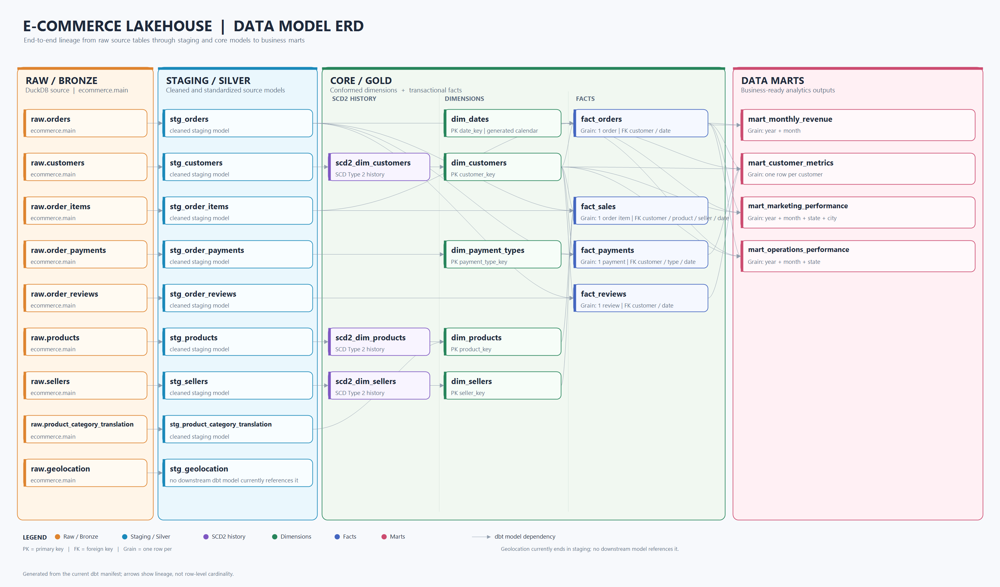

E-Commerce Lakehouse Pipeline
Modern Data Engineering project using:

Cloudflare R2
DuckDB
dbt
Apache Airflow
Docker
Fly.io
Power BI
Architecture:

[DBML source for dbdiagram.io](docs/ecommerce_data_model.dbml)

CSV → Bronze → Silver → Gold → Power BI

Medallion Architecture:

Bronze = Raw Data
Silver = Cleaned Data
Gold = Analytics Layer